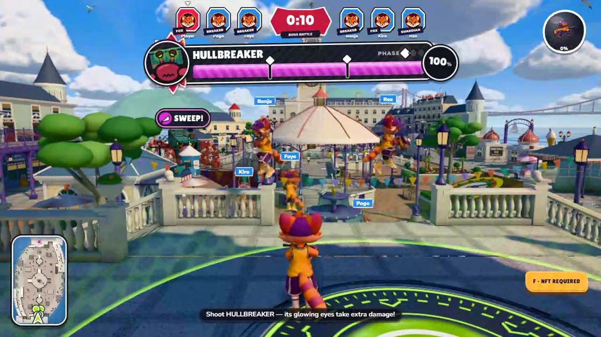
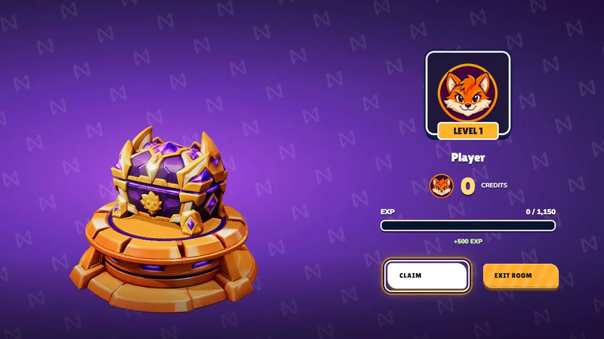

# FOXO: Plaza Showdown



Six Foxes drop into the seaside plaza. In **Trait Hunt**, they have five minutes to restore four target traits. In **Boss Battle**, the squad fights Hullbreaker through three phases. Bring a Fox from your NEAR Testnet wallet to use its traits in battle and build its career across matches.

[Open the game](https://foxo-plaza.vercel.app/) · [Run locally](#run-locally) · [Inspect the Testnet evidence](#the-testnet-record)

*Boss Battle captured in a shortened local demo. Use the public link above for the current build.*

## Enter the Plaza

**Pick a match.** Choose **Play** for Quick Play, **Online** to create or join a private room, or **Boss Battle** to fight Hullbreaker. **Choose Mode** uses a gameplay-preview carousel with direct mode tabs for Trait Control, Daily Trials, Plaza Cup, Decoy Hunt Practice, Skill Workshop, and Fox Economy.

**Bring a Fox.** Connect **Intear** on **NEAR Testnet**. **My NFT** shows the Foxes in your wallet and lets you equip one. If eligible, use **Claim** to get a starter Fox and 10 testnet FOXO while inventory lasts.

**Between matches.** Open **Fox Economy** for crafting, markets, guilds, buy orders, activity, and ranking. The Boss lobby has the Boss Pool. Wallet transactions are reviewed in the wallet before signing.

**Controls.** WASD moves, mouse aims, left click fires, Space jumps, Tab opens the tactical map, and Esc pauses. In modes with Super Jump, click an eligible map pin or use its number key. In Boss Battle, F activates the equipped Trait Power when available.

- **Quick Play · Trait Hunt**. Six players have five minutes to restore four target traits. Eligible server-verified results can feed match rewards, progression, and the mode leaderboard.
- **Online · Private Rooms**. Create or join a room using a code. Bots can fill empty slots when the match starts. Friends can bring equipped Foxes; reward eligibility follows the configured rules.
- **Boss Battle · Hullbreaker**. Fight through three phases. Fox trait roles help break shields, protect the squad, or heal allies. Verified results feed Fox career progression; eligible clears can qualify the player for Boss Pool.
- **Trait Control**. Two teams of three compete to capture and hold three stations. Control results have their own ranking campaign.
- **Daily Trials**. Race the clock and activate eight beacons. Trial results feed a separate leaderboard and can count toward crafting licenses.
- **Plaza Cup**. Practice the three-run beacon course solo or enter Competition with a verified NEAR session. Competition records completed rounds on the relay and ranks total time.
- **Decoy Hunt Practice**. Learn how to deploy false Carrier signals and distract rival Hunters in a 90-second match.
- **Skill Workshop**. Build and equip a Fox ability for Boss Battle within a point budget. Boss progression opens skill options. Workshop is a loadout screen and includes six starting presets. Passport lets players compare Fox traits and inspect their Boss role.

Guided Hunt teaches the Carrier objective in a short practice match. Private-room hosts can switch between Hunt, Boss, and Control before starting while keeping the party together. Trait Hunt supports a replay timeline and local clip or frame export. Public replay sharing requires participant consent and an authoritative recording.

Guest practice uses in-game credits. Testnet rewards require an eligible relay result and campaign funding.

## From the arena to Fox Economy



*Guest practice reward screen from the local demo.*

The browser renders the arena and handles player input. The relay runs the authoritative simulation for reward-eligible matches and keeps a settlement queue. NEAR contracts enforce ownership, inventory, campaign budgets, and claims. The player signs wallet actions such as purchases, staking, and withdrawals.

- **Fox Genesis NFTs**. Equip a Fox for its portrait, traits, and Boss role. The collection shares a rigged 3D Fox model. The collection records ownership. Passport records career entries and time-limited usage rights; the collection exposes an ownership epoch so a transfer can invalidate an old loan.
- **Match rewards and ranking**. Complete eligible matches, then claim any confirmed FOXO reward from the game. The relay simulates matches and submits authorized results. Economy applies campaign limits, records entitlements, and tracks claim payouts. Ranking campaigns have separate settlement from fixed match rewards.
- **Crafting and equipment**. Earn Alloy, Core, and Catalyst, unlock recipe licenses through eligible play, and spend materials and FOXO to craft. Economy stores versioned recipes, inventory, and fees, with a NEP-245 interface for materials and crafted items. The game reads item ownership before applying supported cosmetic equipment.
- **Markets and buy orders**. Browse and list cosmetics or Fox NFTs, place buy orders, and withdraw available proceeds to your wallet. Economy handles cosmetic listings and escrowed buy orders. The separate Market contract handles Fox NFT listings and settlement in FOXO. Quartermaster is a pilot buyer with its own funded order.
- **Guilds**. Browse Top Guilds, open a Guild profile, or use the Create Guild tab. The Guild Lounge brings together events, RSVPs, trophies, and contracts. Contribute materials to a shared project and earn access to its guild banner. Guild Contracts connect missions to supported game modes. Guild records contributions and project completion. The Economy upgrade adds a separate path for funded mission rewards; upgrading or funding the contract does not prove a mission campaign or payout.
- **Boss Pool**. Qualify through a verified Boss clear, then stake FOXO and claim any accrued reward under the campaign rules. Pool records eligible clears, separates deposits from reward funding, and handles claims and withdrawals. The seven-day pilot window is independent of the five-minute match. No Fox NFT is staked.
- **Access and reporting**. Connect via Intear; social onboarding and gas sponsorship are separate pilots. The relay verifies wallet signatures. The sponsorship pilot covers eligible Pool registration, and the indexer reads finalized events for reconciliation.

## Hosting and verification

The public Vercel link forwards multiplayer requests to a relay with an authoritative simulation worker. The Railway deployment supports practice rooms with the host browser running the simulation. Plaza Cup Competition and reward settlement require an authoritative worker.

## The Testnet record

**Network:** NEAR Testnet · **Snapshot:** [finalized block 277,722,627](https://testnet.nearblocks.io/blocks/277722627), 2026-11-14 23:06:51 UTC. The [JSON evidence](docs/evidence/foxo-testnet-finalized.json) records the block hash, deployed code hashes, method arguments and responses, and finalized transaction outcomes.

### Deployed contracts

| Contract | Testnet address | Verified at the snapshot |
| --- | --- | --- |
| Fox Genesis collection | [fox.xuancanh1.testnet](https://testnet.nearblocks.io/address/fox.xuancanh1.testnet) | `nft_total_supply` returned **88**; `get_ownership_epoch` responded for Fox #088. |
| FOXO fungible token | [foxo.xuancanh1.testnet](https://testnet.nearblocks.io/address/foxo.xuancanh1.testnet) | `ft_total_supply` and `ft_metadata` confirmed **1,000,000 FOXO**, with 24 decimals. This account references a NEAR global contract. |
| Starter claims | [claim.xuancanh1.testnet](https://testnet.nearblocks.io/address/claim.xuancanh1.testnet) | **41 Fox NFTs** and **4,970 FOXO** remained available. |
| Economy | [economy.xuancanh1.testnet](https://testnet.nearblocks.io/address/economy.xuancanh1.testnet) | Settlement, crafting, and buy orders enabled. Violet, Aurora, and Tide recipes present; the fixed reward campaign was open. |
| Passport | [passport.xuancanh1.testnet](https://testnet.nearblocks.io/address/passport.xuancanh1.testnet) | Career appends enabled and the Fox Genesis collection configured. |
| Boss Pool | [pool.xuancanh1.testnet](https://testnet.nearblocks.io/address/pool.xuancanh1.testnet) | Campaign opened with **1,500 FOXO** available for rewards. Principal and paid rewards were both zero at the snapshot. |
| Guild | [guild.xuancanh1.testnet](https://testnet.nearblocks.io/address/guild.xuancanh1.testnet) | Config points to the deployed Economy and FOXO contracts. |
| Fox NFT Market | [market.xuancanh1.testnet](https://testnet.nearblocks.io/address/market.xuancanh1.testnet) | Enabled and configured for the Fox collection, Passport, and FOXO. |

### Finalized transactions

These transactions returned `FINAL`, with a successful execution result and no failed outcome receipts.

| Evidence | Confirmed action |
| --- | --- |
| [Fox ownership upgrade](https://testnet.nearblocks.io/txns/GvUFXYj6cYEcFfTofZj1HbZ4BXLP3FWsBPHLxp8iDeta) | Deployed upgraded code to the existing Fox NFT account; the collection still reported 88 NFTs. |
| [Economy upgrade](https://testnet.nearblocks.io/txns/6EoJ5smGRaV9fDjNTeASjxuCKgxBzphc2yso2gRxotjE) | Deployed updated Economy code to its existing account. |
| [Ranking campaign activation](https://testnet.nearblocks.io/txns/C1y6vJBn82ZitJhJAtNMwXvzxFnNBfv59eb4CxER1Ddk) | Opened campaigns for Trait Hunt, Trait Control, and Daily Trials. |
| [Boss Pool activation](https://testnet.nearblocks.io/txns/H66NBZBvrMU7mVGcjjZWMDqPpik5rxU5ZDiE6nZEw17) | Assigned the verified-result signer and opened the seven-day Pool campaign. |
| [Quartermaster pilot order](https://testnet.nearblocks.io/txns/D6FYiRBGV5qhfaGApA8UgjZXXibWR4yNqMMTvpfw44nE) | Funded a buy order for one Violet Fox Finish with **10 FOXO**. One unit was still open at the snapshot. |
| [Economy reward funding](https://testnet.nearblocks.io/txns/5MMaYH1uwQgbrbUfRunPrUpASGVPkciiNi43e6XcFTp1) | Economy accepted **10 FOXO** into reward funding. Campaign assignment and payout are separate actions. |

The Economy reward ledger and Boss Pool both reported zero FOXO paid at that block.

<details>
<summary>Re-run the Fox supply check</summary>

For independent verification, use the [NEAR JSON-RPC reference](https://docs.near.org/api/rpc/introduction). Read a contract at the snapshot's `block.hash` and use each transaction's recorded signer when asking for its final status. The JSON stores token quantities in atomic units; one FOXO is 10²⁴ atomic units.

For example, this read-only request rechecks the Fox supply at the cited block:

```bash
node --input-type=module -e "import {testnetRequest} from './server/near/testnet-rpc.mjs'; const r=await testnetRequest('query',{request_type:'call_function',account_id:'fox.xuancanh1.testnet',method_name:'nft_total_supply',args_base64:'e30=',block_id:'HZ8mTs2N9aZd8GFbAwwqndJdZ7ymFWtRxStCzW5vnZN6'}); const j=await r.json(); if(j.error) throw Error(JSON.stringify(j.error)); console.log(JSON.parse(Buffer.from(j.result.result).toString()));"
```

</details>

## Run locally

Requires **Node.js 24**, **Python 3**, and a browser with WebGL 2. Run these commands from the directory containing this README:

```bash
npm ci
npm run build
npm run serve -- 8817
```

Open [http://127.0.0.1:8817/dist/](http://127.0.0.1:8817/dist/). In a second terminal, start the local NEAR room and wallet verification relay:

```bash
node server/near-relay.mjs
```

The default relay listens on port **8818**. The local game uses that port automatically; use `?huntRelay=<relay-url>` for a different server. This default setup is for gameplay and development. It does not configure a settlement signer or issue FOXO rewards for local matches.

```bash
npm run check
node --test tools/near/near-quickplay.test.mjs tools/near/career-chain.test.mjs tools/near/guild-mission-rewards.test.mjs
```

<details>
<summary>Source map</summary>

| Area | Location |
| --- | --- |
| Three.js game and in-game interfaces | [src/](src/) · [assets/near-fox/](assets/near-fox/) |
| Rooms, wallet verification, settlement, and reconciliation | [server/near-relay.mjs](server/near-relay.mjs) · [server/near/](server/near/) |
| Rust smart contracts and Sandbox scenarios | [contracts/](contracts/) · [Economy Sandbox](contracts/near-economy/sandbox/) |
| Deployment and pilot policy | [config/](config/) · [tools/near/](tools/near/) |
| Evidence and test history | [Finalized Testnet snapshot](docs/evidence/foxo-testnet-finalized.json) |

</details>

## License

[MIT License](LICENSE).
